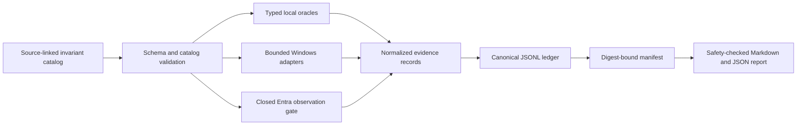

# Identity Invariant Architecture

## Purpose and trust model

The harness distinguishes specification-derived decisions from product
observations. It does not promote a local parser result into a hosted-service
claim, and it does not turn an unmet laboratory prerequisite into a pass or a
failure. Every record therefore carries an invariant identifier, an evidence
class, an explicit outcome, and a stable reason code.

The primary trust boundaries are:

1. The catalog binds each invariant to one stable identifier, a primary HTTPS
   source, a source revision, a section, and an evidence class.
2. Local oracles accept typed structures and return normalized decisions. They
   never perform network I/O.
3. Observation adapters normalize only allow-listed fields. Raw inputs are
   transient and remain outside the committed evidence tree.
4. `EvidenceWriter` commits canonical JSON lines, then seals their exact bytes,
   record count, and format version in a manifest.
5. The report renderer verifies the manifest before reading records and rejects
   unsafe content before atomically replacing either output file.

## Protocol state boundaries

### Workload identity, token exchange, and OIDC

JWT claim parsing keeps strings, arrays, integers, and booleans distinct.
Issuer, audience, subject, algorithm, key trust, time, nonce, and replay state
are evaluated as separate invariants. Token exchange parsing preserves
parameter multiplicity and rejects ambiguous target or rights combinations
before policy evaluation.

The Entra adapter adds a second boundary around live observations. A request
budget is consumed before transport, response retention is allow-listed, and a
failed or malformed response cannot reopen the budget. A closed gate emits a
normalized `skip` without constructing a transport request.

### MS-PAC

The PAC parser checks descriptor counts, multiplication bounds, alignment,
offset-plus-size regions, overlap, signature shapes, SID layout, and configured
resource ceilings before exposing typed buffers. Windows capture adapters pass
only the exact authorization-data region into this parser and retain hashes and
normalized buffer metadata, never ticket bytes.

### dMSA and Cloud Kerberos Trust

PowerShell harnesses model dMSA transitions as directory graph observations:
state, reciprocal migration links, temporary ACL edges, enrollment, SPN and
policy transfer, RWDC/RODC origin, events, and checkpoint restoration. An
operation result alone is insufficient; the graph before and after the
transition is authoritative for the observation.

The Cloud Kerberos gate inventories prerequisites without mutation. A Server
2025 RWDC, Azure AD Kerberos object, password replication policy, selected
Cloud Trust policy, Windows 11 client, client line of sight, and partial-TGT
observation are independent conditions. RWDC-local reachability cannot satisfy
the Windows 11 client line-of-sight invariant.

## Evidence lifecycle

Records are serialized with sorted keys and compact separators. Input and
artifact values are represented by domain-separated SHA-256 digests. Sealing
creates a manifest that binds the ledger filename, exact digest, record count,
and format version. The public report manifest additionally records a bounded
environment fingerprint and hashes for its source ledgers.

The report pipeline is deterministic:

- catalog rules are ordered by invariant identifier;
- observations are ordered by rule, case, outcome, and reason;
- mappings and JSON keys are sorted;
- output uses UTF-8 and LF line endings;
- integration coverage regenerates both outputs and requires byte equality.

Before writing, the renderer rejects oversized output, NUL bytes, private-key
markers, bearer headers, credential-shaped fields, token-shaped values, local
credential paths, and UUID-shaped raw identifiers. It applies the same screen
to every raw ledger line, including metadata that is not rendered.

## Laboratory isolation

Ubuntu executes Python builds, property tests, manifest verification, and
report generation. Windows Server 2025 provides the isolated identity topology:
`ID-DC01`, `ID-RODC01`, and `ID-SRV01` on the private `Bluex-Identity` switch.
The topology has no NAT adapter or default route. Each mutating Windows case
starts from the exact three-node checkpoint set and ends with checkpoint
restoration, AD Web Services readiness, graph digest verification, and a valid
member secure channel.

The host coordinates Git and moves only normalized artifacts. It does not run
protocol reproducers or compile laboratory code.

## Interpretation limits

`observe` means that a bounded state was measured in the declared laboratory;
it does not independently establish specification conformance. `skip` means a
required context was absent. `inconclusive` means the retained evidence cannot
resolve the invariant. CWE and CVSS remain unassigned until independent product
behavior and impact are confirmed.
